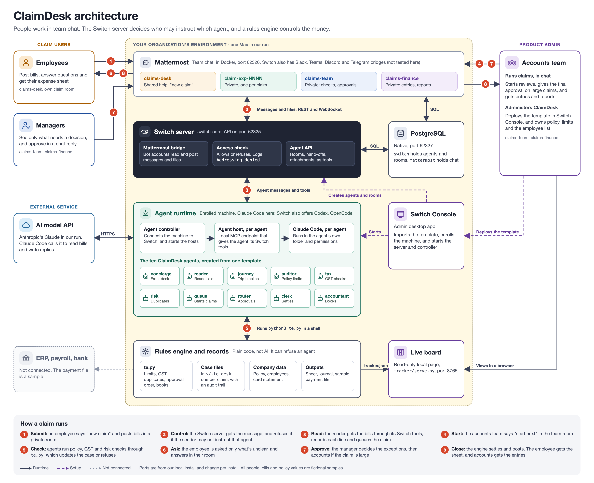
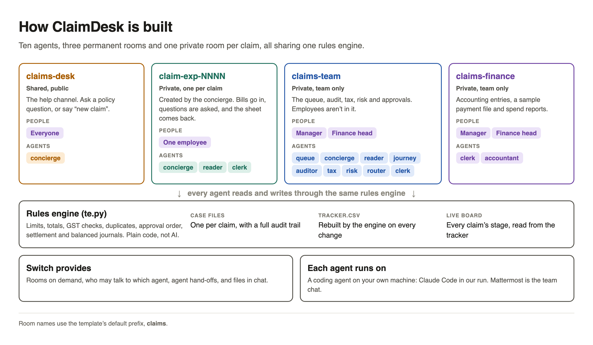
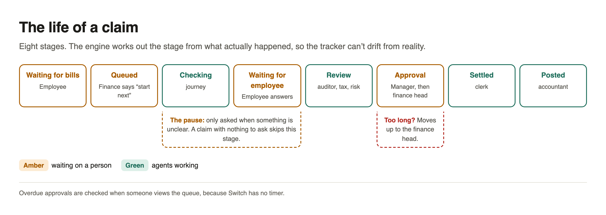
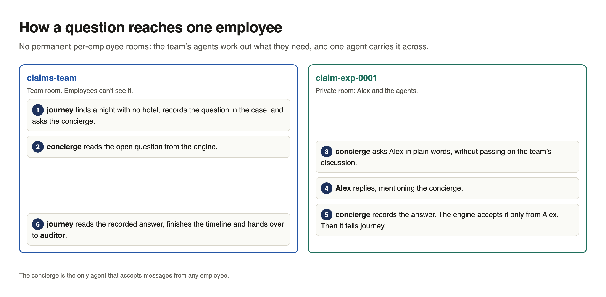
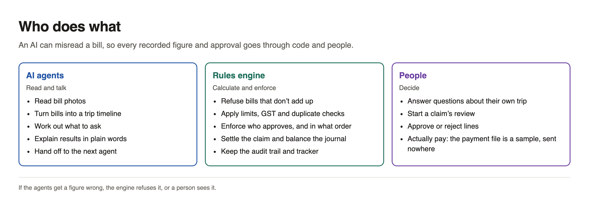
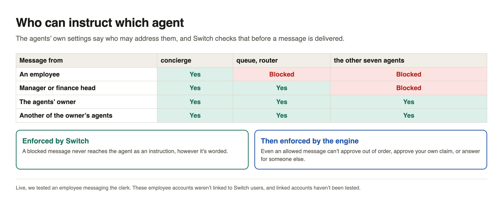

# ClaimDesk technical design

How ClaimDesk works, and how much of a real travel and expense (T&E) department it covers.

All policy values, tax rules, people and companies are fictional samples. They aren't tax or accounting advice, so a real company must replace them.

## Goal

An employee posts bills in team chat and is only asked what's actually unclear. Agents do the reading and checking, code does the calculating, and named people make the decisions.

## Architecture



### Running components

Checked against the running processes and Switch's code on Switch Console 0.40.1 with core 0.31.0. Ports are from one local install, and change per install.

| Component | What it is | Connects to |
|---|---|---|
| Switch Console | Desktop admin app | Starts the Switch server and agent controller, and calls the server's API |
| Mattermost | Team chat, in Docker (port 62326) | Its own database in PostgreSQL |
| Switch server | `switch-core`, API on port 62325 | Mattermost through bot accounts (REST and WebSocket), and PostgreSQL. It runs the access check before delivering a message to an agent |
| PostgreSQL | Native process (port 62327) | Holds the `switch` and `mattermost` databases |
| Agent controller | Sidecar process, on the enrolled machine | The Switch server. Starts the agent hosts |
| Agent host | One process per running agent | Serves that agent a local MCP endpoint, and has a WebSocket route to the Switch server |
| Claude Code | One process per running agent, in the agent's own folder | Its agent host, the AI model API over HTTPS, and `te.py` through a shell |
| Rules engine | `te.py`, copied into each agent's folder | Shared files in `~/.te-desk` |
| Live board | `tracker/serve.py` (port 8765) | Reads `tracker.json`, and changes nothing |

Agents run on demand, so not all ten are running at any moment. A claim never passes through Switch Console, which is only used for setup.



| Part | File | Role |
|---|---|---|
| Template | `claimdesk.template.yaml` | Defines the 10 agents, the rooms and who can instruct whom |
| Rules engine | `engine/te.py` | Standard-library Python CLI that agents run. It owns all calculations and state changes |
| Excel builder | `engine/build_expense_sheet.py` | Writes the expense sheet, which includes the audit trail |
| Sample data | `engine/data/` | Policy, employees, pre-approvals, advances, card statement, exchange rates, opening ledger |
| Live board | `tracker/` | Read-only local web page showing `tracker.json` |
| Install script | `install.sh` | Copies the engine into each agent's folder, sets permissions and sets up the data |
| Account script | `create-test-accounts.sh` | Creates the local Mattermost test accounts |

### Rooms

| Room | Who's in it | What happens |
|---|---|---|
| `claims-desk` | Everyone; `concierge` | Shared help channel: policy questions and "new claim" |
| `claim-exp-NNNN` | One employee; `concierge`, `reader`, `clerk` | Created per claim: bills, questions, final sheet |
| `claims-team` (private) | Finance; `queue`, `concierge`, `reader`, `journey`, `auditor`, `tax`, `risk`, `router`, `clerk` | Queue, audit, tax, risk and approvals, out of the employee's view |
| `claims-finance` (private) | Finance; `clerk`, `accountant` | Settlement, accounting entries, payment file, reports |

### Agents

| Agent | Job | Who can instruct it |
|---|---|---|
| `concierge` | Answers policy questions, starts claims, relays questions and answers | Anyone |
| `queue` | Shows open claims, starts the next one, escalates overdue approvals | People in the team room |
| `router` | Asks approvers in order, and records their decisions | People in the team room |
| `reader` | Turns bill photos into one line per item | The deployer and their agents |
| `journey` | Builds the trip timeline, and works out what only the employee can answer | The deployer and their agents |
| `auditor` | Checks policy limits and budget | The deployer and their agents |
| `tax` | Checks GST details and credit | The deployer and their agents |
| `risk` | Checks duplicates and card charges | The deployer and their agents |
| `clerk` | Settles the claim, and sends the sheet to that employee | The deployer and their agents |
| `accountant` | Posts entries, and writes the sample payment file and report | The deployer and their agents |

## Claim flow



| Step | Who | What happens |
|---|---|---|
| 1 | Employee | Says "new claim" to `concierge` in the help channel |
| 2 | `concierge` | Starts the case and opens a private room for the bills |
| 3 | `reader` | Reads every bill, records one line per item, and queues the claim |
| 4 | Finance, `queue` | A person in the team room says "start next" |
| 5 | `journey` | Builds the timeline, and works out what only the employee can answer |
| 6 | `concierge` | Asks in the private room, and brings the answer back to the team room |
| 7 | `auditor`, `tax`, `risk` | Check limits, GST, duplicates and card charges |
| 8 | `router`, approvers | Approvers see only what needs a decision |
| 9 | `clerk` | Settles the claim and sends the sheet to that employee only |
| 10 | `accountant` | Posts balanced entries, a sample payment file and a spend report |



### Stages

A claim is in one of eight stages: Waiting for bills, Queued, Checking, Waiting for employee, Review, Approval, Settled, Posted.

The engine's `stage()` function works the stage out from the case itself. Nothing sets it by hand, so the tracker can't disagree with what happened.

### Escalation

Each approval request starts a clock, set by `approval_expiry_minutes` in the policy (default 1,440, or 24 hours). `policy.escalation` says who an overdue approval moves to, which is the finance head for a manager.

Switch has no timer, so `te.py escalate` runs when someone views the queue. After an escalation, the engine refuses the original approver.

## Who decides what



| Decision | Who | Enforced by |
|---|---|---|
| Arithmetic, limits, checksums | Code | `te.py` |
| Reading a bill | `reader` | Totals must reconcile, or `te.py` refuses |
| Whether a card charge was personal | Employee | `te.py answer` accepts only the claim's employee |
| Starting a claim's review | Finance | `queue`, only when a person says so |
| Approving or rejecting | Named people | `te.py decide`, and Switch access rules |
| Paying | Finance, outside this system | The payment file isn't sent anywhere |

The engine enforces these rules:

- **Reconciliation:** it refuses bills whose items don't add up to the printed total.
- **Rules:** limits, per diem, GSTIN checksums, duplicates and approval levels are code, not judgment.
- **Approvals:** it refuses self-approval, approvals out of order, and duplicates being approved.
- **Books:** it won't settle before every approval is in, won't settle again after posting, won't post a journal that doesn't balance, and won't post twice.
- **Audit trail:** it records every step in the case, and the trail goes into the sheet.

## Data

State lives in `~/.te-desk`, or wherever `TE_HOME` points.

| File | Contents |
|---|---|
| `cases/EXP-NNNN.json` | One case: trip, bills, lines, journey, questions, approvals, settlement, posting, audit trail |
| `ledger.json` | The ledger |
| `tracker.csv`, `tracker.json` | Every claim's stage, rebuilt on each save |
| `data/` | The working copy of the sample data |

Agents share this folder, which is how a claim moves between rooms.

## Access and permissions



There are three separate layers:

1. **Switch `addressing`:** decides who can instruct an agent at all. In the live run, it blocked an employee's message to the clerk with `Addressing denied`.
2. **Agent instructions:** in the live run, the concierge refused a false "I am the manager" request.
3. **The engine:** refuses invalid actions, whatever an agent or a person says.

`install.sh` also sets Claude Code permissions for each agent:

| Agent | Rule | Why |
|---|---|---|
| `clerk`, `accountant` | Allow `te.py settle`, `sheet`, `post` | The permission check can read these as real-world transactions. They only calculate and write local files, and the engine refuses them until approvals are recorded |
| `queue` | Allow `te.py escalate` | The check can read this as a change to a shared resource. It only follows the policy's escalation rule |
| `concierge` | Deny commands that change money or approvals | It's open to anyone. This is a safeguard, not a sandbox |

## Department coverage

**Built** means code or agents do it today. **Partly** means a simple version exists. **Future** means it isn't built.

| Area | Item | Status |
|---|---|---|
| Before the trip | Policy questions, entitlement by grade and city, estimates, budget check | Built |
| | Pre-trip approval record, travel advance | Partly: read from a file, no request workflow |
| | Booking, visa, insurance, traveler safety | Future |
| Capturing | Bill photos in a private room, one row per item, unreadable values, foreign currency | Built |
| | Lost bills, mileage | Partly |
| | Email or card-feed intake | Future |
| Checking the trip | Timeline and gaps, business purpose | Built |
| | Personal days | Partly: recorded, with no automatic split |
| Policy, tax, risk | Hotel, meal and flight rules, bill requirement, late submission | Built |
| | GSTIN checksum, input tax credit | Built, with sample rules |
| | Duplicates in the claim and against past claims, card charges with no bill | Built |
| | Unusual-pattern detection | Partly: round amounts only |
| | Withholding and payroll tax, altered-image detection | Future |
| Approvals | Levels by amount, line-level decisions, blocking self-approval, access limits, escalation | Built |
| | Delegates and reminders | Future |
| Queue and tracking | "Start next", tracker file, live board, "Where's my claim?" | Built |
| Paying, accounting | Per diem, card reconciliation, personal charges, advance settlement, Excel sheet, balanced entries by cost center | Built |
| | Payment file | Built, sample only |
| | ERP or payroll connection | Future |
| Oversight | Audit trail, spend and exception report | Built |
| | Open advances and aging, data privacy controls | Partly |
| | Retention rules, spot audits, supplier negotiation | Future |

## The sample case

Six bills from a Delhi to Pune trip, 13 to 16 Oct 2026, by a Grade 3 employee, with planted problems:

| Planted problem | Who catches it | Outcome |
|---|---|---|
| No hotel on the night of the 15th | `journey`, via `concierge` | Employee answers: stayed with family |
| ₹1,250 card charge with no bill | The engine, via `journey` and `concierge` | Employee answers: personal, so it's recovered |
| Taxi receipt `CAB-1147` appears twice | `risk` | Rejected automatically as a duplicate |
| ₹1,860 dinner over the ₹1,500 limit | `auditor` | Approver decides |
| Hotel bill made out to the employee | `tax` | ₹1,008 GST can't be claimed as credit |
| Claim over the ₹24,000 budget | `auditor` | Shown to the approvers |
| Over ₹25,000 | `router` | Needs manager and finance head |

If the dinner is approved:

| Figure | Amount |
|---|---|
| Bills approved | ₹25,218.00 |
| Per diem, 4 days at ₹800 | ₹3,200.00 |
| **Total expense** | **₹28,418.00** |
| Paid by company card, for approved items | ₹24,018.00 |
| Reimbursable to employee, cash taxis plus per diem | ₹4,400.00 |
| Less advance | −₹2,000.00 |
| Less personal card charge | −₹1,250.00 |
| **Paid to employee** | **₹1,150.00** |

## Testing

The unit tests need only Python's standard library:

```bash
python3 engine/test_te.py
python3 engine/test_build_expense_sheet.py
```

**Proven in the live Mattermost run on 6 Nov 2026:**

- A private claim room with several agents, and bills reaching the reader.
- Questions through the concierge, with answers back in the team room.
- Switch blocking an employee's message to the clerk.
- The concierge refusing a false manager claim.
- Maya being unable to see Alex's room or claim status.
- An out-of-turn approver refused, and two different approvers signing off.
- An overdue approval moving up, with the late approver refused.
- The full run: ₹28,418.00 total, ₹1,150.00 to the employee and a balanced journal. Its outputs are in `samples/output/`.

## Known limits

- It has had one full live run, in Mattermost, with clean sample images and not real photos.
- A full claim hasn't yet run on a fresh install of the final template. That install's rooms, privacy and engine were checked without one.
- The concierge's deny rules were never triggered in the run.
- The test accounts aren't linked to Switch users, and a linked account hasn't been tested.
- Switch starts agents in Claude Code's `auto` mode, whose safety check can still block `te.py settle` despite the allow rule. It passed on one live claim and was blocked on another, and the clerk stops and reports it when that happens.
- Claim rooms are private from other employees, but the agents' owner and Mattermost's `admin` are also members.
- Overdue approvals are only checked when someone views the queue.
- The approval flow records usernames that agents pass in. The engine checks them against the employee list, but relies on the agent reporting the true sender.
- A pause of several days hasn't been run live.
- The docs say Microsoft Teams doesn't pass attached files to agents, so this flow won't work there. Only Mattermost has been tested.
- The engine has to be installed by hand after the rooms are created.
- Payment files are samples and aren't sent anywhere.
